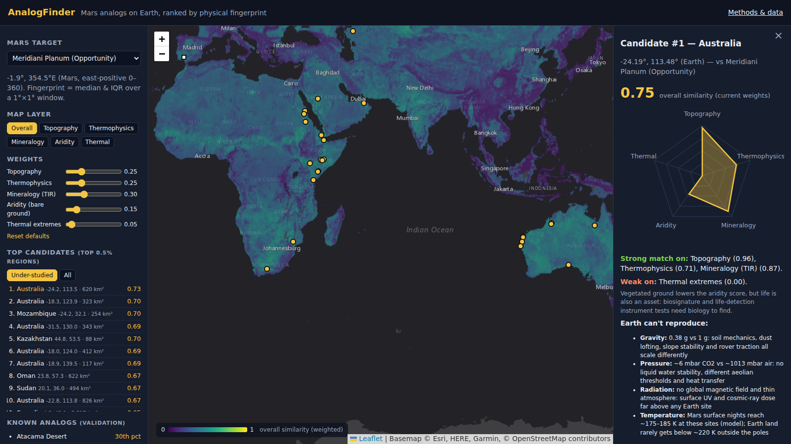

# AnalogFinder — a cross-planet fingerprint search engine for Mars analogs on Earth

NASA Space Apps Challenge 2026 · *Find and characterize new terrestrial analogs for Moon/Mars landing sites and bases.*

Most analog work compares photos. **AnalogFinder compares physics.** For a Mars target (Jezero, Gale, Meridiani) we
build a five-dimension fingerprint from orbital Mars data. We then build the *same* fingerprint for every 0.05° land cell on Earth
from NASA Earth data and rank the planet, per dimension and overall. Both planets have been mapped in the
**thermal infrared** (TES on Mars, MODIS and ASTER on Earth), so the thermophysics and mineralogy comparisons rest on the
same kind of measurement, not on appearance.

Every result states **what matches**, **how well** (0–1 per dimension) and **where the analogy breaks** (gravity, pressure,
radiation, temperature, biology).

| Dimension | Mars | Earth |
|---|---|---|
| Topography (3.7 km baseline, 18.5 km windows) | MOLA MEGDR 1/16° | Copernicus GLO-90 → 1/30° |
| Thermophysics | TES thermal inertia + albedo | MODIS apparent thermal inertia (MYD11C3 day/night LST + MCD43C3 albedo) + albedo |
| Mineralogy (TIR) | TES mineral maps → mafic / silica / dust | ASTER GED bands 10–14 → mafic index, quartz index, spectral contrast |
| Aridity | NDVI ≡ 0 | ASTER GED NDVI |
| Thermal extremes | 1-D thermal model from TES TI + albedo | MODIS monthly LST |

See [`web/methods.html`](web/methods.html) for formulas and limitations, and [`data/SOURCES.md`](data/SOURCES.md) for every file's URL, DOI, version and access date.

## Results

Validation: percentile of each known analog among all valid 0.05° land cells (cell at the site coordinate; best cell within ±0.125°).

| Known analog | Jezero Crater | Gale Crater | Meridiani Planum |
|---|---|---|---|
| Atacama Desert | 76 (best nearby 92) | 96 (best nearby 97) | 30 (best nearby 55) |
| Mojave / Death Valley | 48 (best nearby 91) | 98 (best nearby 99) | 47 (best nearby 79) |
| Utah MDRS | 33 (best nearby 79) | 68 (best nearby 88) | 36 (best nearby 63) |
| Iceland highlands | 86 (best nearby 98) | 82 (best nearby 92) | 55 (best nearby 79) |
| Mauna Kea flanks | 8 (best nearby 82) | 56 (best nearby 93) | 29 (best nearby 91) |
| Rio Tinto | 92 (best nearby 93) | 83 (best nearby 84) | 88 (best nearby 88) |
| Haughton Crater | 68 (best nearby 97) | 92 (best nearby 99) | 38 (best nearby 59) |

### Jezero Crater (Perseverance) — top 5 candidate regions (all within the top 0.5% of land)

Target fingerprint (1°×1° window, medians): TES TI 289 J m⁻² K⁻¹ s⁻½ (Mars percentile 0.82), albedo 0.175, relief 478 m, slope 1.5°, composition mafic/silica/fines 0.49/0.27/0.11, modelled surface T 181–288 K.

| # | Location (lat, lon) | Country | Area km² | Overall | Topo | Thermo | Mineral | Aridity | Extremes | Near known analog |
|---|---|---|---|---|---|---|---|---|---|---|
| 1 | 19.17, 41.52 | Saudi Arabia | 17,253 | **0.81** | 0.88 | 0.90 | 0.81 | 0.80 | 0.00 | — |
| 2 | 65.04, 162.34 | Russia | 1,004 | **0.82** | 0.91 | 0.84 | 0.81 | 0.90 | 0.00 | — |
| 3 | 54.49, 158.42 | Russia | 126 | **0.83** | 0.94 | 0.93 | 0.85 | 0.74 | 0.00 | — |
| 4 | 62.89, 157.79 | Russia | 99 | **0.83** | 0.92 | 0.86 | 0.81 | 0.96 | 0.00 | — |
| 5 | 10.40, 11.47 | Nigeria | 122 | **0.83** | 0.94 | 0.93 | 0.86 | 0.65 | 0.00 | — |

### Gale Crater (Curiosity) — top 5 candidate regions (all within the top 0.5% of land)

Target fingerprint (1°×1° window, medians): TES TI 317 J m⁻² K⁻¹ s⁻½ (Mars percentile 0.89), albedo 0.223, relief 1531 m, slope 5.2°, composition mafic/silica/fines 0.38/0.39/0.18, modelled surface T 178–292 K.

| # | Location (lat, lon) | Country | Area km² | Overall | Topo | Thermo | Mineral | Aridity | Extremes | Near known analog |
|---|---|---|---|---|---|---|---|---|---|---|
| 1 | 76.41, -25.19 | Greenland | 189 | **0.88** | 0.92 | 0.88 | 0.94 | 1.00 | 0.00 | — |
| 2 | 73.22, -81.30 | Canada | 36 | **0.90** | 0.93 | 0.95 | 0.95 | 0.95 | 0.00 | — |
| 3 | 82.29, -41.85 | Greenland | 41 | **0.89** | 0.95 | 0.95 | 0.90 | 1.00 | 0.00 | — |
| 4 | 76.72, -25.20 | Greenland | 71 | **0.89** | 0.94 | 0.95 | 0.89 | 1.00 | 0.00 | — |
| 5 | -51.34, -73.38 | Chile | 77 | **0.88** | 0.99 | 0.95 | 0.95 | 0.75 | 0.00 | — |

### Meridiani Planum (Opportunity) — top 5 candidate regions (all within the top 0.5% of land)

Target fingerprint (1°×1° window, medians): TES TI 223 J m⁻² K⁻¹ s⁻½ (Mars percentile 0.52), albedo 0.133, relief 77 m, slope 0.3°, composition mafic/silica/fines 0.55/0.33/0.11, modelled surface T 175–306 K.

| # | Location (lat, lon) | Country | Area km² | Overall | Topo | Thermo | Mineral | Aridity | Extremes | Near known analog |
|---|---|---|---|---|---|---|---|---|---|---|
| 1 | -24.19, 113.48 | Australia | 620 | **0.73** | 0.95 | 0.79 | 0.72 | 0.51 | 0.00 | — |
| 2 | -18.26, 123.94 | Australia | 323 | **0.70** | 0.95 | 0.91 | 0.68 | 0.20 | 0.00 | — |
| 3 | -24.15, 32.10 | Mozambique | 254 | **0.70** | 0.93 | 0.73 | 0.74 | 0.41 | 0.00 | — |
| 4 | -31.50, 130.00 | Australia | 343 | **0.69** | 0.83 | 0.81 | 0.80 | 0.29 | 0.00 | — |
| 5 | 44.78, 53.48 | Kazakhstan | 88 | **0.70** | 0.68 | 0.62 | 0.76 | 0.99 | 0.00 | — |

Full report: [`results/REPORT.md`](results/REPORT.md) · validation: [`results/validation.md`](results/validation.md) · candidates: `results/candidates_<target>.csv` · cards: [`results/analog_cards/`](results/analog_cards/)



## Run from scratch

```bash
python3 -m venv .venv && . .venv/bin/activate && pip install -r requirements.txt
# Earthdata access: put an EDL token in ~/.earthdata_token (or export EARTHDATA_TOKEN),
# or EARTHDATA_USERNAME/EARTHDATA_PASSWORD, or ~/.netrc.
# Mars inputs go in data/raw/mars/ (see data/SOURCES.md for the URLs):
#   megt90n000eb.img, Mars_MGS_TES_Albedo_mosaic_global_7410m.tif, nmap2003.bin, nmsk2003.bin, tes_minerals/*.vic

python scripts/inspect_mars.py            # MVP-0: Mars shapes/ranges + orientation checks + quicklooks
python src/download_earth.py modis        # MYD11C3 x12 + MCD43C3 x24 (~5.6 GB)
python src/download_earth.py ag1km        # ASTER GED 1 km, 24,873 tiles (~11 GB)
python src/download_dem.py                # Copernicus GLO-90 -> 1/30 deg (public AWS, overview reads)
python scripts/quicklook_earth.py         # MVP-0: Earth quicklooks
python src/features_mars.py               # Mars features + target fingerprints (+ thermal model)
python scripts/check_thermal_model.py     # model vs Opportunity's observed 295 K
python src/features_earth.py              # Earth features on the 0.05 deg grid
python src/similarity.py                  # per-dimension + overall similarity rasters
python src/validate.py                    # results/validation.md
python src/candidates.py                  # results/candidates_<target>.csv
python src/case_study.py jezero 3         # Analog Cards (AG100 + EMIT + GLO-30); also gale / meridiani
python src/export_web.py                  # web/data/*
python scripts/make_report.py             # results/REPORT.md + README results tables
python -m http.server -d web 8000         # open http://localhost:8000
pytest -q                                 # unit tests
```

Runtime on 4 vCPU / 16 GB: downloads ~30 min, Earth features ~10 min, everything else a few minutes.

## Repository

```
config.yaml            targets (Mars lon east-positive 0-360), windows, weights, scales, masks
src/                   geo, io_mars, topo (identical on both planets), stats, features_*, similarity, validate,
                       candidates, export_web, case_study, download_*, mars_thermal_model
scripts/               inspection, quicklooks and debugging aids
results/               validation.md, candidates_<target>.csv, analog_cards/, quicklooks/, REPORT.md
web/                   static single-page app (Leaflet), deployable to GitHub Pages as-is
tests/                 longitude conventions, orientation flips, scale factors/QC bits, ATI, percentiles, similarity
```

## Data credits

NASA LP DAAC (MODIS MYD11C3/MCD43C3 v061, ASTER GED v003, EMIT L2B v001); NASA PDS Geosciences Node (MOLA MEGDR);
USGS Astrogeology (TES albedo mosaic); Putzig & Mellon (TES thermal inertia); ASU Mars Space Flight Facility (TES mineral
maps); ESA Copernicus DEM GLO-90/GLO-30 (© DLR e.V. 2010-2014 and © Airbus Defence and Space GmbH 2014-2018, provided under
COPERNICUS by the European Union and ESA); Natural Earth; basemap © Esri, HERE, Garmin, © OpenStreetMap contributors.
