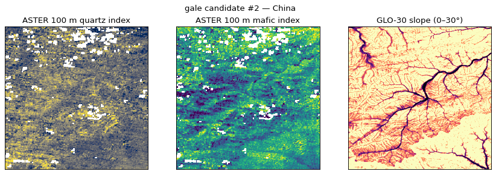

# Analog Card — China (40.53, 76.66) vs Gale Crater (Curiosity)

Under-studied candidate #2 for Gale Crater (Curiosity) · region area 141 km² · mean overall score **0.86** (top 0.5% of Earth's land) · nearest listed analog 6182 km away.

## What matches, and how well (0–1)

| Dimension | Score | Mars target (median [IQR]) | Earth region |
|---|---|---|---|
| Topography | 0.88 | relief 1531 m, slope 5.2° | relief 571 m, slope 2.4° |
| Thermophysics | 0.84 | TI pct 0.89 [0.69, 0.95], albedo 0.22 [0.22, 0.23] | ATI pct 0.70, albedo 0.20 |
| Mineralogy (TIR) | 0.95 | mafic/silica/fines 0.38/0.39/0.18 | 0.33/0.36/0.30 |
| Aridity | 0.74 | NDVI 0 | NDVI 0.08 |
| Thermal extremes | 0.72 | ΔT 89 K, min 178 K (model) | ΔT 19 K, min 249 K |

**Strong:** Topography, Thermophysics, Mineralogy (TIR), Aridity, Thermal extremes. **Weak:** —.

## Zoom-in evidence (≈33 km box)

- **ASTER GED 100 m** (86,791 px): bare fraction (NDVI<0.15) 95%, median NDVI 0.08, quartz index 1.009, mafic index 0.972, TIR contrast 0.032.
- **EMIT L2B minerals 60 m** (443,951 px from 4 scene(s)): Calcite in 21% of pixels (random-pixel baseline 15%), Montmorillonite in 20% of pixels (random-pixel baseline 5%), Goethite in 9% of pixels (random-pixel baseline 4%), Illite+Muscovite in 9% of pixels (random-pixel baseline 3%). (Pixel fraction with the mineral in group-1 or group-2 identification and positive band depth; baseline = 80,000 random pixels from the same scenes.)
- **Blind prediction check** (minerals expected from the Mars target, not used in scoring): Montmorillonite 20.4% vs baseline 4.7%, Kaolinite 0.0% vs baseline 0.0%, Gypsum 0.0% vs baseline 0.0%.
- **Copernicus GLO-30 DEM**: relief 2081 m, median 30 m slope 30.0°, 90th pct 37.4°, 90% of the box steeper than 15° (landing-hazard proxy).

## Where the analogy breaks

- **Gravity** 1 g vs 0.38 g; **pressure** ~1013 mbar vs ~6 mbar (no stable liquid water on Mars, different aeolian thresholds).
- **Radiation**: Earth's magnetic field and atmosphere shield the surface; Mars surface UV/GCR dose is orders of magnitude higher.
- **Temperature** (thermal-extremes score 0.72): Mars target ΔT 89 K, min 178 K (model) vs Earth region ΔT 19 K, min 249 K (coldest monthly-mean night LST).

## Mission tests it could support

- rover mobility and landing-hazard tests on terrain with Mars-like relief and slope statistics.
- thermal-inertia-based landing-site certification, regolith/bedrock discrimination with TIR cameras.
- TIR/VNIR spectrometer field validation (TES/THEMIS/Mini-TES-style instruments) on a matching composition mix.
- contamination-controlled sampling and life-detection limits in near-sterile ground.
- ISRU and aqueous-mineral detection (hydrated/oxidised minerals mapped by EMIT).

_Generated by `src/case_study.py` from the candidates CSV, ASTER GED AG100, EMIT L2B MIN and Copernicus GLO-30._