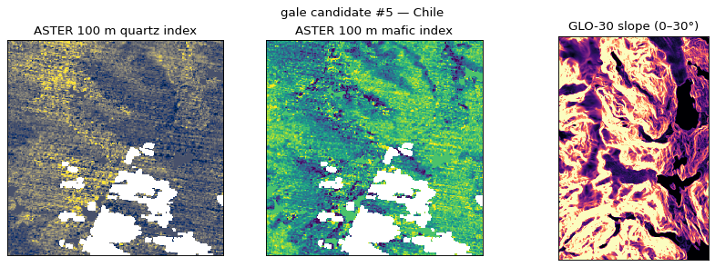

# Analog Card — Chile (-51.34, -73.38) vs Gale Crater (Curiosity)

Under-studied candidate #5 for Gale Crater (Curiosity) · region area 77 km² · mean overall score **0.88** (top 0.5% of Earth's land) · nearest listed analog 3005 km away.

## What matches, and how well (0–1)

| Dimension | Score | Mars target (median [IQR]) | Earth region |
|---|---|---|---|
| Topography | 0.99 | relief 1531 m, slope 5.2° | relief 1062 m, slope 5.3° |
| Thermophysics | 0.95 | TI pct 0.89 [0.69, 0.95], albedo 0.22 [0.22, 0.23] | ATI pct 0.87, albedo 0.16 |
| Mineralogy (TIR) | 0.95 | mafic/silica/fines 0.38/0.39/0.18 | 0.34/0.33/0.34 |
| Aridity | 0.75 | NDVI 0 | NDVI 0.07 |
| Thermal extremes | 0.00 | ΔT 89 K, min 178 K (model) | ΔT 9 K, min 264 K |

**Strong:** Topography, Thermophysics, Mineralogy (TIR), Aridity. **Weak:** Thermal extremes.

## Zoom-in evidence (≈33 km box)

- **ASTER GED 100 m** (78,366 px): bare fraction (NDVI<0.15) 70%, median NDVI 0.02, quartz index 1.009, mafic index 0.980, TIR contrast 0.025.
- **EMIT L2B minerals 60 m** (1,001,548 px from 4 scene(s)): Goethite in 1% of pixels, Calcite in 1% of pixels. (Pixel fraction where the mineral appears in group-1 or group-2 identification with positive band depth.)
- **Copernicus GLO-30 DEM**: relief 2047 m, median 30 m slope 17.8°, 90th pct 41.4°, 56% of the box steeper than 15° (landing-hazard proxy).

## Where the analogy breaks

- **Gravity** 1 g vs 0.38 g; **pressure** ~1013 mbar vs ~6 mbar (no stable liquid water on Mars, different aeolian thresholds).
- **Radiation**: Earth's magnetic field and atmosphere shield the surface; Mars surface UV/GCR dose is orders of magnitude higher.
- **Temperature** (thermal-extremes score 0.00): Mars target ΔT 89 K, min 178 K (model) vs Earth region ΔT 9 K, min 264 K (coldest monthly-mean night LST).

## Mission tests it could support

- rover mobility and landing-hazard tests on terrain with Mars-like relief and slope statistics.
- thermal-inertia-based landing-site certification, regolith/bedrock discrimination with TIR cameras.
- TIR/VNIR spectrometer field validation (TES/THEMIS/Mini-TES-style instruments) on a matching composition mix.
- contamination-controlled sampling and life-detection limits in near-sterile ground.

_Generated by `src/case_study.py` from the candidates CSV, ASTER GED AG100, EMIT L2B MIN and Copernicus GLO-30._