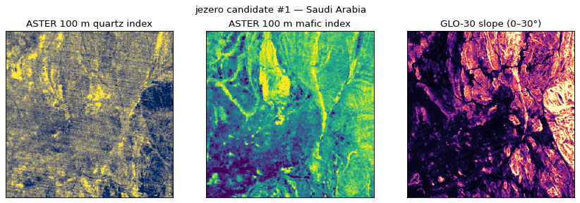

# Analog Card — Saudi Arabia (19.17, 41.52) vs Jezero Crater (Perseverance)

Under-studied candidate #1 for Jezero Crater (Perseverance) · region area 17253 km² · mean overall score **0.81** (top 0.5% of Earth's land) · nearest listed analog 5070 km away.

## What matches, and how well (0–1)

| Dimension | Score | Mars target (median [IQR]) | Earth region |
|---|---|---|---|
| Topography | 0.88 | relief 478 m, slope 1.5° | relief 252 m, slope 0.7° |
| Thermophysics | 0.90 | TI pct 0.82 [0.70, 0.92], albedo 0.18 [0.17, 0.18] | ATI pct 0.69, albedo 0.20 |
| Mineralogy (TIR) | 0.81 | mafic/silica/fines 0.49/0.27/0.11 | 0.51/0.10/0.38 |
| Aridity | 0.80 | NDVI 0 | NDVI 0.05 |
| Thermal extremes | 0.00 | ΔT 93 K, min 181 K (model) | ΔT 17 K, min 296 K |

**Strong:** Topography, Thermophysics, Mineralogy (TIR), Aridity. **Weak:** Thermal extremes.

## Zoom-in evidence (≈33 km box)

- **ASTER GED 100 m** (90,000 px): bare fraction (NDVI<0.15) 99%, median NDVI 0.05, quartz index 0.999, mafic index 0.982, TIR contrast 0.029.
- **EMIT L2B minerals 60 m** (444,109 px from 4 scene(s)): Calcite in 46% of pixels, Illite+Muscovite in 42% of pixels, Kaolinite in 24% of pixels, Chlorite in 15% of pixels. (Pixel fraction where the mineral appears in group-1 or group-2 identification with positive band depth.)
- **Copernicus GLO-30 DEM**: relief 1635 m, median 30 m slope 5.2°, 90th pct 25.4°, 26% of the box steeper than 15° (landing-hazard proxy).

## Where the analogy breaks

- **Gravity** 1 g vs 0.38 g; **pressure** ~1013 mbar vs ~6 mbar (no stable liquid water on Mars, different aeolian thresholds).
- **Radiation**: Earth's magnetic field and atmosphere shield the surface; Mars surface UV/GCR dose is orders of magnitude higher.
- **Temperature** (thermal-extremes score 0.00): Mars target ΔT 93 K, min 181 K (model) vs Earth region ΔT 17 K, min 296 K (coldest monthly-mean night LST).

## Mission tests it could support

- rover mobility and landing-hazard tests on terrain with Mars-like relief and slope statistics.
- thermal-inertia-based landing-site certification, regolith/bedrock discrimination with TIR cameras.
- TIR/VNIR spectrometer field validation (TES/THEMIS/Mini-TES-style instruments) on a matching composition mix.
- contamination-controlled sampling and life-detection limits in near-sterile ground.
- ISRU and aqueous-mineral detection (hydrated/oxidised minerals mapped by EMIT).

_Generated by `src/case_study.py` from the candidates CSV, ASTER GED AG100, EMIT L2B MIN and Copernicus GLO-30._