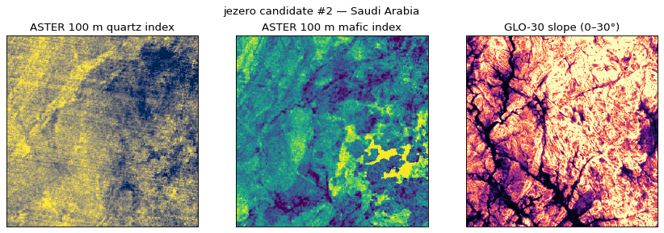

# Analog Card — Saudi Arabia (20.50, 40.58) vs Jezero Crater (Perseverance)

Under-studied candidate #2 for Jezero Crater (Perseverance) · region area 5646 km² · mean overall score **0.84** (top 0.5% of Earth's land) · nearest listed analog 4906 km away.

## What matches, and how well (0–1)

| Dimension | Score | Mars target (median [IQR]) | Earth region |
|---|---|---|---|
| Topography | 0.87 | relief 478 m, slope 1.5° | relief 641 m, slope 2.0° |
| Thermophysics | 0.89 | TI pct 0.82 [0.70, 0.92], albedo 0.18 [0.17, 0.18] | ATI pct 0.83, albedo 0.18 |
| Mineralogy (TIR) | 0.84 | mafic/silica/fines 0.49/0.27/0.11 | 0.51/0.26/0.26 |
| Aridity | 0.86 | NDVI 0 | NDVI 0.05 |
| Thermal extremes | 0.28 | ΔT 93 K, min 181 K (model) | ΔT 16 K, min 294 K |

**Strong:** Topography, Thermophysics, Mineralogy (TIR), Aridity. **Weak:** Thermal extremes.

## Zoom-in evidence (≈33 km box)

- **ASTER GED 100 m** (90,000 px): bare fraction (NDVI<0.15) 100%, median NDVI 0.05, quartz index 1.003, mafic index 0.990, TIR contrast 0.031.
- **EMIT L2B minerals 60 m** (327,955 px from 4 scene(s)): Calcite in 30% of pixels (random-pixel baseline 38%), Illite+Muscovite in 23% of pixels (random-pixel baseline 39%), Chlorite in 6% of pixels (random-pixel baseline 10%), Hematite in 4% of pixels (random-pixel baseline 11%). (Pixel fraction with the mineral in group-1 or group-2 identification and positive band depth; baseline = 80,000 random pixels from the same scenes.)
- **Blind prediction check** (minerals expected from the Mars target, not used in scoring): Calcite 29.9% vs baseline 37.8%, Dolomite 1.2% vs baseline 1.1%, Montmorillonite 0.8% vs baseline 1.6%.
- **Copernicus GLO-30 DEM**: relief 2043 m, median 30 m slope 21.1°, 90th pct 34.4°, 66% of the box steeper than 15° (landing-hazard proxy).

## Where the analogy breaks

- **Gravity** 1 g vs 0.38 g; **pressure** ~1013 mbar vs ~6 mbar (no stable liquid water on Mars, different aeolian thresholds).
- **Radiation**: Earth's magnetic field and atmosphere shield the surface; Mars surface UV/GCR dose is orders of magnitude higher.
- **Temperature** (thermal-extremes score 0.28): Mars target ΔT 93 K, min 181 K (model) vs Earth region ΔT 16 K, min 294 K (coldest monthly-mean night LST).

## Mission tests it could support

- rover mobility and landing-hazard tests on terrain with Mars-like relief and slope statistics.
- thermal-inertia-based landing-site certification, regolith/bedrock discrimination with TIR cameras.
- TIR/VNIR spectrometer field validation (TES/THEMIS/Mini-TES-style instruments) on a matching composition mix.
- contamination-controlled sampling and life-detection limits in near-sterile ground.

_Generated by `src/case_study.py` from the candidates CSV, ASTER GED AG100, EMIT L2B MIN and Copernicus GLO-30._