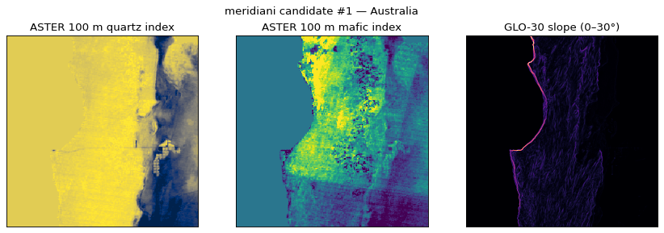

# Analog Card — Australia (-24.19, 113.47) vs Meridiani Planum (Opportunity)

Under-studied candidate #1 for Meridiani Planum (Opportunity) · region area 508 km² · mean overall score **0.75** (top 0.5% of Earth's land) · nearest listed analog 10994 km away.

## What matches, and how well (0–1)

| Dimension | Score | Mars target (median [IQR]) | Earth region |
|---|---|---|---|
| Topography | 0.95 | relief 77 m, slope 0.3° | relief 58 m, slope 0.2° |
| Thermophysics | 0.63 | TI pct 0.52 [0.46, 0.62], albedo 0.13 [0.13, 0.14] | ATI pct 0.69, albedo 0.18 |
| Mineralogy (TIR) | 0.87 | mafic/silica/fines 0.55/0.33/0.11 | 0.57/0.32/0.12 |
| Aridity | 0.49 | NDVI 0 | NDVI 0.10 |
| Thermal extremes | 0.46 | ΔT 109 K, min 175 K (model) | ΔT 20 K, min 284 K |

**Strong:** Topography, Thermophysics, Mineralogy (TIR). **Weak:** —.

## Zoom-in evidence (≈33 km box)

- **ASTER GED 100 m** (61,039 px): bare fraction (NDVI<0.15) 98%, median NDVI 0.11, quartz index 1.000, mafic index 0.997, TIR contrast 0.108.
- **EMIT L2B minerals 60 m** (517,908 px from 4 scene(s)): Hematite in 47% of pixels (random-pixel baseline 20%), Calcite in 31% of pixels (random-pixel baseline 8%), Gypsum in 13% of pixels (random-pixel baseline 3%), Illite+Muscovite in 7% of pixels (random-pixel baseline 5%). (Pixel fraction with the mineral in group-1 or group-2 identification and positive band depth; baseline = 80,000 random pixels from the same scenes.)
- **Blind prediction check** (minerals expected from the Mars target, not used in scoring): Hematite 46.6% vs baseline 19.8%, Gypsum 13.1% vs baseline 3.1%.
- **Copernicus GLO-30 DEM**: relief 116 m, median 30 m slope 0.0°, 90th pct 2.7°, 0% of the box steeper than 15° (landing-hazard proxy).

## Where the analogy breaks

- **Gravity** 1 g vs 0.38 g; **pressure** ~1013 mbar vs ~6 mbar (no stable liquid water on Mars, different aeolian thresholds).
- **Radiation**: Earth's magnetic field and atmosphere shield the surface; Mars surface UV/GCR dose is orders of magnitude higher.
- **Temperature** (thermal-extremes score 0.46): Mars target ΔT 109 K, min 175 K (model) vs Earth region ΔT 20 K, min 284 K (coldest monthly-mean night LST).
- **Biology**: vegetation/soil life present — a drawback for sterility, an asset for biosignature-detection tests.

## Mission tests it could support

- rover mobility and landing-hazard tests on terrain with Mars-like relief and slope statistics.
- thermal-inertia-based landing-site certification, regolith/bedrock discrimination with TIR cameras.
- TIR/VNIR spectrometer field validation (TES/THEMIS/Mini-TES-style instruments) on a matching composition mix.
- landing-zone and EDL-sensor tests (gentle slopes over most of the box).
- ISRU and aqueous-mineral detection (hydrated/oxidised minerals mapped by EMIT).

_Generated by `src/case_study.py` from the candidates CSV, ASTER GED AG100, EMIT L2B MIN and Copernicus GLO-30._