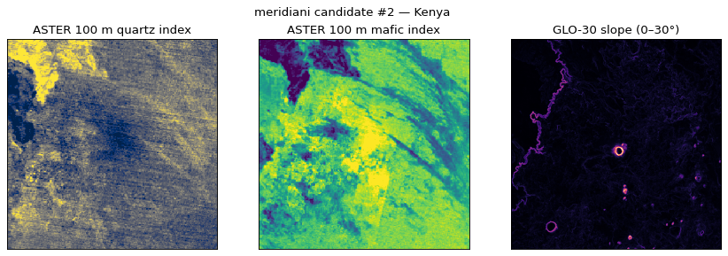

# Analog Card — Kenya (2.64, 37.79) vs Meridiani Planum (Opportunity)

Under-studied candidate #2 for Meridiani Planum (Opportunity) · region area 185 km² · mean overall score **0.74** (top 0.5% of Earth's land) · nearest listed analog 5964 km away.

## What matches, and how well (0–1)

| Dimension | Score | Mars target (median [IQR]) | Earth region |
|---|---|---|---|
| Topography | 0.87 | relief 77 m, slope 0.3° | relief 163 m, slope 0.5° |
| Thermophysics | 0.61 | TI pct 0.52 [0.46, 0.62], albedo 0.13 [0.13, 0.14] | ATI pct 0.76, albedo 0.16 |
| Mineralogy (TIR) | 0.71 | mafic/silica/fines 0.55/0.33/0.11 | 0.28/0.46/0.25 |
| Aridity | 0.96 | NDVI 0 | NDVI 0.03 |
| Thermal extremes | 0.30 | ΔT 109 K, min 175 K (model) | ΔT 19 K, min 296 K |

**Strong:** Topography, Thermophysics, Mineralogy (TIR), Aridity. **Weak:** Thermal extremes.

## Zoom-in evidence (≈33 km box)

- **ASTER GED 100 m** (90,000 px): bare fraction (NDVI<0.15) 100%, median NDVI 0.03, quartz index 1.012, mafic index 0.968, TIR contrast 0.041.
- **EMIT L2B minerals 60 m** (305,020 px from 4 scene(s)): Hematite in 88% of pixels (random-pixel baseline 41%), Calcite in 32% of pixels (random-pixel baseline 14%), Chlorite in 6% of pixels (random-pixel baseline 6%), Goethite in 2% of pixels (random-pixel baseline 1%). (Pixel fraction with the mineral in group-1 or group-2 identification and positive band depth; baseline = 80,000 random pixels from the same scenes.)
- **Blind prediction check** (minerals expected from the Mars target, not used in scoring): Hematite 88.5% vs baseline 41.0%, Gypsum 0.0% vs baseline 0.0%.
- **Copernicus GLO-30 DEM**: relief 394 m, median 30 m slope 0.9°, 90th pct 2.5°, 0% of the box steeper than 15° (landing-hazard proxy).

## Where the analogy breaks

- **Gravity** 1 g vs 0.38 g; **pressure** ~1013 mbar vs ~6 mbar (no stable liquid water on Mars, different aeolian thresholds).
- **Radiation**: Earth's magnetic field and atmosphere shield the surface; Mars surface UV/GCR dose is orders of magnitude higher.
- **Temperature** (thermal-extremes score 0.30): Mars target ΔT 109 K, min 175 K (model) vs Earth region ΔT 19 K, min 296 K (coldest monthly-mean night LST).

## Mission tests it could support

- rover mobility and landing-hazard tests on terrain with Mars-like relief and slope statistics.
- thermal-inertia-based landing-site certification, regolith/bedrock discrimination with TIR cameras.
- TIR/VNIR spectrometer field validation (TES/THEMIS/Mini-TES-style instruments) on a matching composition mix.
- contamination-controlled sampling and life-detection limits in near-sterile ground.
- landing-zone and EDL-sensor tests (gentle slopes over most of the box).
- ISRU and aqueous-mineral detection (hydrated/oxidised minerals mapped by EMIT).

_Generated by `src/case_study.py` from the candidates CSV, ASTER GED AG100, EMIT L2B MIN and Copernicus GLO-30._