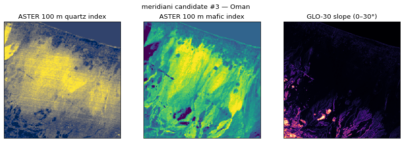

# Analog Card — Oman (23.78, 57.26) vs Meridiani Planum (Opportunity)

Under-studied candidate #3 for Meridiani Planum (Opportunity) · region area 368 km² · mean overall score **0.72** (top 0.5% of Earth's land) · nearest listed analog 6178 km away.

## What matches, and how well (0–1)

| Dimension | Score | Mars target (median [IQR]) | Earth region |
|---|---|---|---|
| Topography | 0.80 | relief 77 m, slope 0.3° | relief 133 m, slope 0.4° |
| Thermophysics | 0.82 | TI pct 0.52 [0.46, 0.62], albedo 0.13 [0.13, 0.14] | ATI pct 0.55, albedo 0.17 |
| Mineralogy (TIR) | 0.49 | mafic/silica/fines 0.55/0.33/0.11 | 0.42/0.32/0.27 |
| Aridity | 0.98 | NDVI 0 | NDVI 0.02 |
| Thermal extremes | 0.45 | ΔT 109 K, min 175 K (model) | ΔT 23 K, min 288 K |

**Strong:** Topography, Thermophysics, Aridity. **Weak:** —.

## Zoom-in evidence (≈33 km box)

- **ASTER GED 100 m** (82,756 px): bare fraction (NDVI<0.15) 93%, median NDVI 0.02, quartz index 1.009, mafic index 1.015, TIR contrast 0.014.
- **EMIT L2B minerals 60 m** (569,655 px from 4 scene(s)): Calcite in 67% of pixels (random-pixel baseline 71%), Dolomite in 62% of pixels (random-pixel baseline 36%), Hematite in 47% of pixels (random-pixel baseline 33%), Goethite in 32% of pixels (random-pixel baseline 20%). (Pixel fraction with the mineral in group-1 or group-2 identification and positive band depth; baseline = 80,000 random pixels from the same scenes.)
- **Blind prediction check** (minerals expected from the Mars target, not used in scoring): Hematite 46.6% vs baseline 33.1%, Gypsum 0.2% vs baseline 0.2%.
- **Copernicus GLO-30 DEM**: relief 574 m, median 30 m slope 0.7°, 90th pct 4.2°, 2% of the box steeper than 15° (landing-hazard proxy).

## Where the analogy breaks

- **Gravity** 1 g vs 0.38 g; **pressure** ~1013 mbar vs ~6 mbar (no stable liquid water on Mars, different aeolian thresholds).
- **Radiation**: Earth's magnetic field and atmosphere shield the surface; Mars surface UV/GCR dose is orders of magnitude higher.
- **Temperature** (thermal-extremes score 0.45): Mars target ΔT 109 K, min 175 K (model) vs Earth region ΔT 23 K, min 288 K (coldest monthly-mean night LST).

## Mission tests it could support

- rover mobility and landing-hazard tests on terrain with Mars-like relief and slope statistics.
- thermal-inertia-based landing-site certification, regolith/bedrock discrimination with TIR cameras.
- contamination-controlled sampling and life-detection limits in near-sterile ground.
- landing-zone and EDL-sensor tests (gentle slopes over most of the box).
- ISRU and aqueous-mineral detection (hydrated/oxidised minerals mapped by EMIT).

_Generated by `src/case_study.py` from the candidates CSV, ASTER GED AG100, EMIT L2B MIN and Copernicus GLO-30._